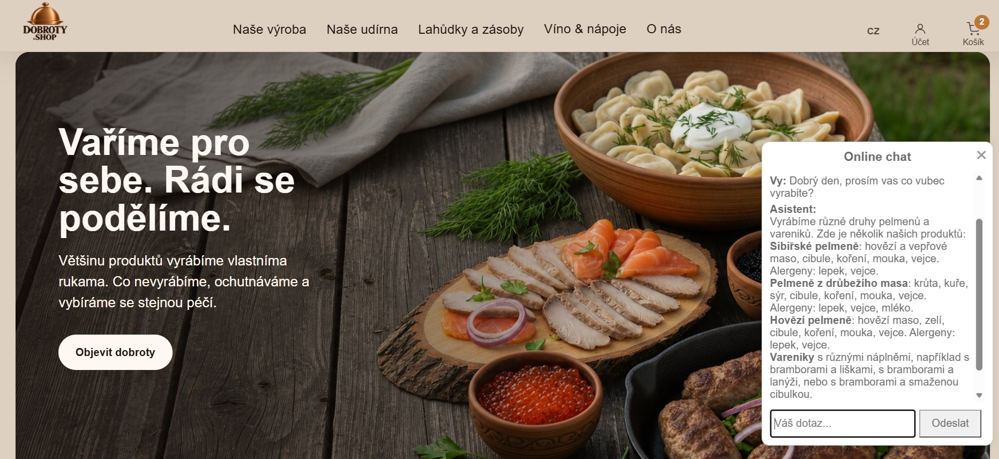
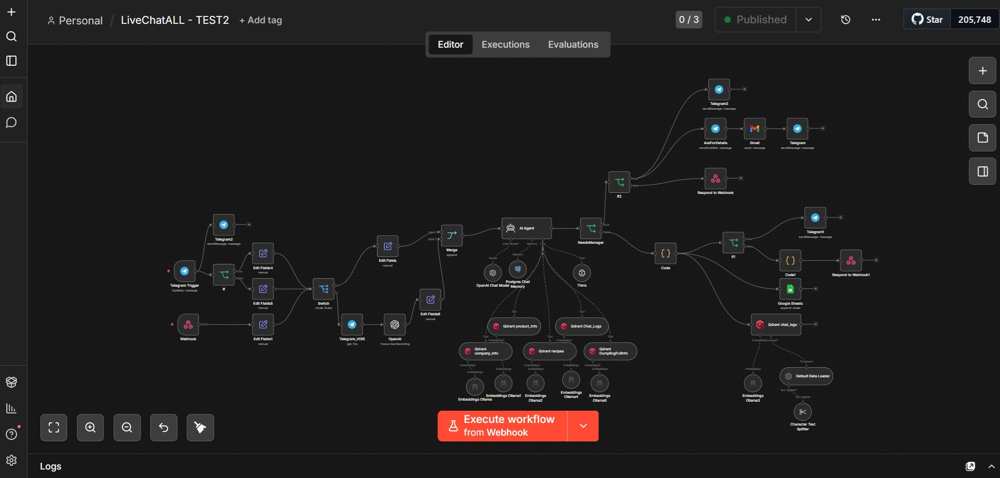
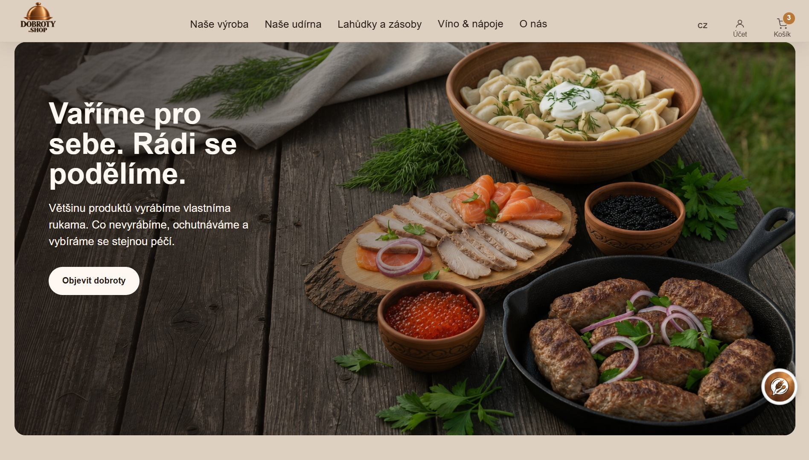
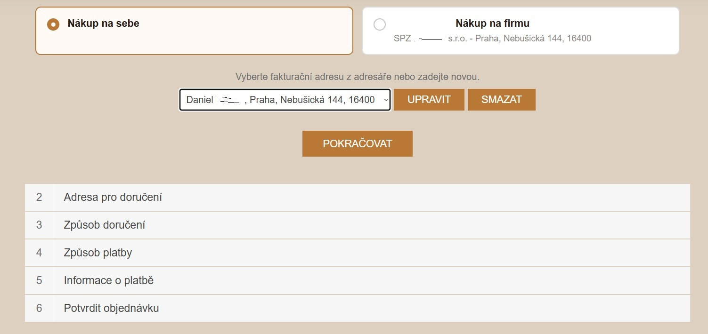
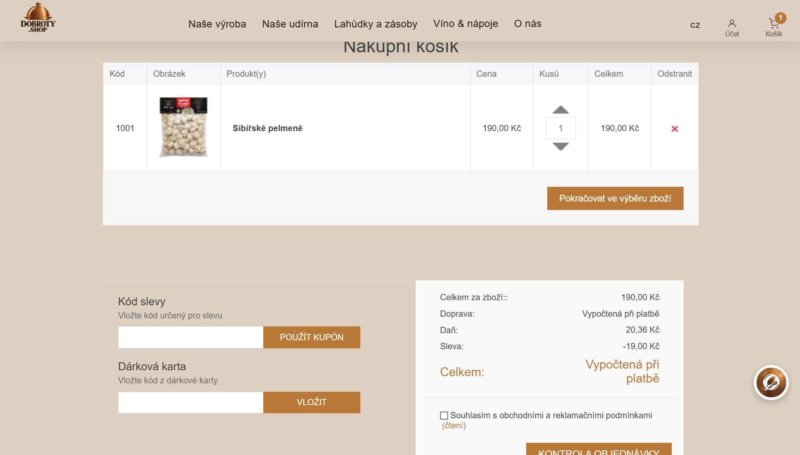
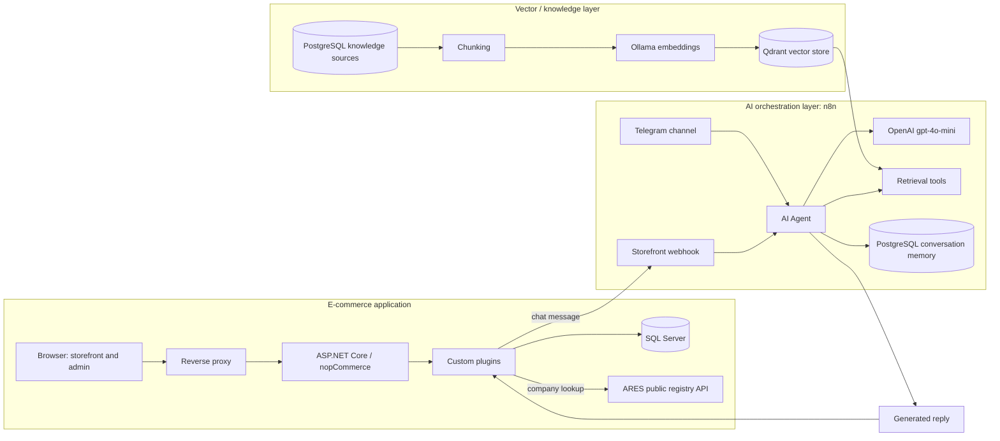

# Dobroty E-commerce & AI Automation Platform

A production-oriented AI automation and business-process integration platform for a Czech food-retail business, built on top of the open-source **nopCommerce** e-commerce engine (ASP.NET Core / .NET 9 / C#).

## My Role

**AI Automation / Integration.** I designed and own the AI and automation layer of this platform end to end:

- AI workflow architecture (n8n orchestration, LLM/RAG integration)
- API integrations (ARES, the AI workflow's webhook contract)
- Business-process automation (order/payment events, scheduled jobs)
- Security hardening of the AI integration
- Testing (backend and frontend/XSS)
- Production deployment

Implementation and review were AI-assisted using Claude, ChatGPT and Codex; I retained ownership of architecture, requirements, validation, testing and deployment.

## Key Capabilities

- Designed and configured an n8n-based AI assistant integrating OpenAI (`gpt-4o-mini`), Qdrant retrieval and PostgreSQL conversation memory.
- Built the RAG knowledge-loading pipeline: PostgreSQL sources → chunking → Ollama embeddings → Qdrant.
- Integrated storefront web chat and Telegram as parallel channels into the same AI workflow, including voice-message transcription through OpenAI.
- Automated business processes on nopCommerce's order lifecycle: document generation, gift-card activation and scheduled loyalty-tier recalculation.
- Integrated the Czech ARES public registry (REST API) for automatic company lookup during B2B checkout.
- Found and closed an XSS exposure in AI-reply rendering, then hardened and deployed the storefront-to-AI-workflow integration to production myself.

## Review in 5 Minutes

- [`samples/livechat/`](samples/livechat/README.md) — a runnable, standalone .NET 9 sample of the hardened chat backend and frontend, with 28 backend tests and a 56-assertion frontend/XSS test harness. Clone, build and run it directly.
- [`samples/n8n/`](samples/n8n/README.md) — sanitized exports of the AI assistant workflow and the RAG knowledge-loading pipeline, importable into a disposable n8n instance for inspection.
- [`portfolio/CASE_STUDY.md`](portfolio/CASE_STUDY.md) — the narrative write-up of finding and fixing the XSS exposure, end to end.

## Screenshots

### AI assistant in production

Customer-support chat connected to the n8n-based AI/RAG workflow.

### n8n AI workflow

AI orchestration workflow covering web chat, Telegram, AI Agent, retrieval tools, PostgreSQL memory, voice transcription and escalation paths.

### Production storefront

Customized nopCommerce storefront used by the food-commerce business.

### Business checkout flow

Customized checkout flow supporting business purchases and company-data handling.

### Shopping cart

Customized cart and checkout experience, including discount and gift-card handling.

## Business Problem

Dobroty needed to move a food-retail store from an older nopCommerce generation to a current one, add business rules a stock e-commerce platform doesn't provide out of the box (Czech B2B invoicing with company lookup, postal-code delivery eligibility, automatic loyalty tiers), and give customers a fast way to ask product questions without adding a full-time support headcount.

## What I Delivered

- Designed, configured and integrated an n8n-based AI assistant: OpenAI (`gpt-4o-mini`) for responses, Ollama for embeddings, Qdrant for RAG retrieval, and PostgreSQL for conversation memory and knowledge sources, serving both a storefront chat widget and a Telegram channel.
- Built the RAG knowledge-loading workflow that prepares, chunks and embeds product, company and recipe content from PostgreSQL into Qdrant.
- Delivered seven custom nopCommerce plugins: loyalty tiers, postal-code delivery eligibility, first-order discounting, Czech tax/proforma invoicing, QR payment instructions, storefront content localization, and the AI chat widget's storefront transport.
- Automated business processes on nopCommerce's order lifecycle: proforma document generation and email queueing on order placement, gift-card activation on payment confirmation, and a scheduled daily loyalty-tier recalculation.
- Integrated the Czech ARES public registry (REST API) for company lookup during B2B checkout.
- Identified and closed an XSS exposure in AI-reply rendering, then validated and hardened the storefront-to-AI-workflow integration end to end (input validation, timeouts, safe logging, sanitized output rendering) — see the [case study](portfolio/CASE_STUDY.md).
- Specified and carried out the checklist-driven production deployment of the hardened integration, including backup verification, staged rollout and rollback readiness.

## What Is Upstream vs Custom

| Layer | Origin |
| --- | --- |
| Commerce engine (catalog, cart, checkout, admin, core services) | **Upstream nopCommerce** — not written by me |
| Base theme | **Upstream**, with targeted Razor view overrides |
| 7 custom plugins (loyalty tiers, delivery, invoicing, QR payment, discount rule, site content, AI chat widget) | **Custom**, written for this project |
| Order-event automation (document generation, gift-card activation, tier recalculation) | **Custom**, built on nopCommerce's plugin/event extension points |
| AI support workflow (n8n orchestration, retrieval, memory) | **Custom** — designed and configured by me, running on infrastructure separate from the storefront; the storefront connects to it through a webhook rather than hosting it inside this codebase |
| Deployment and operations process | **Custom**, manual and checklist-driven |

OpenAI, Ollama, Qdrant and PostgreSQL are third-party software and services. I selected, configured and orchestrate them through the n8n workflow; I did not build them or train a model. nopCommerce itself is a mature open-source commerce platform — the value demonstrated here is in the extension points, the integrations, and the AI/automation engineering built on top of them, not in reimplementing a shopping cart.

## Architecture

Full diagram sources: [diagrams/platform-architecture.mmd](diagrams/platform-architecture.mmd), [diagrams/livechat-ai-flow.mmd](diagrams/livechat-ai-flow.mmd), [diagrams/rag-knowledge-loading.mmd](diagrams/rag-knowledge-loading.mmd), [diagrams/order-document-automation.mmd](diagrams/order-document-automation.mmd). Details: [docs/ARCHITECTURE.md](docs/ARCHITECTURE.md).

## AI Assistant Integration

I designed and configured an n8n-based AI assistant workflow that uses OpenAI (`gpt-4o-mini`) to generate replies, Ollama for embeddings, Qdrant for RAG retrieval, and PostgreSQL for conversation memory and knowledge sources. The same workflow serves both the storefront chat widget and a Telegram channel, and includes voice-message transcription through OpenAI.

I also built the storefront-side transport and hardened it, and reviewed and sanitized the exported workflow definitions for this portfolio. See [docs/AI_ASSISTANT.md](docs/AI_ASSISTANT.md) for what is directly verified from the workflow export versus owner-reported versus still unvalidated, and [samples/n8n/](samples/n8n/README.md) for runnable, sanitized copies of both workflows.

## Business Automation

- **Order-event automation** — placing an order triggers proforma/tax document generation and queued email delivery; marking an order paid triggers gift-card activation.
- **Scheduled customer loyalty tiers** — a scheduled task promotes/demotes customers between tiers based on lifetime order value, with wholesale customers excluded and manual admin override available.
- **ARES company lookup** — autofills company name, VAT number and address from the Czech business registry during checkout.
- **Postal-code delivery eligibility** — checkout enforces a whitelist of deliverable postal codes with configurable delivery slots and a free-shipping threshold.
- **QR payment instructions** — generates a scannable Czech payment QR code (SPD format) for bank-transfer orders.
- **First-order discount rule** — a custom nopCommerce discount requirement rule targeting customers with no prior completed orders.

Details, including which parts are still partially implemented rather than fully hardened: [docs/BUSINESS_AUTOMATION.md](docs/BUSINESS_AUTOMATION.md).

## Security: Treating AI Output as Untrusted Input

A language model's reply is external, attacker-influenceable content, not trusted application data. This integration renders AI replies as Markdown, so a naive implementation would pass a model's raw output straight into the page. The rendering path closes that gap: **AI reply → Markdown parsing (`marked`) → sanitization (`DOMPurify`, explicit allowlist) → controlled HTML rendering.** Only the assistant's sanitized reply is ever inserted as HTML; user input and error text are always rendered as plain text.

On the backend, the storefront-to-workflow transport has message-length and request-size limits, a bounded timeout with clean cancellation handling, explicit mapping of every upstream failure mode to a safe response, and logging that records outcome and timing but never message content or the webhook address.

I found the original XSS exposure during a security review of this integration, fixed it in two independently deployable passes (backend, then frontend), verified both with targeted tests, and deployed the result to production myself. This covers the chat integration specifically, not the platform as a whole. Full write-up: [docs/SECURITY_HARDENING.md](docs/SECURITY_HARDENING.md) and [portfolio/CASE_STUDY.md](portfolio/CASE_STUDY.md). A standalone, runnable demonstration — with its own 28 backend tests and a 56-assertion frontend/XSS test harness — is included at [samples/livechat/](samples/livechat/README.md).

## Technology Stack

| Category | Technologies |
| --- | --- |
| AI / automation | n8n, OpenAI, Ollama, Qdrant, PostgreSQL (for the AI workflow) |
| Frontend security dependencies | marked, DOMPurify (vendored, pinned versions) |
| Backend | C#, ASP.NET Core MVC on .NET 9, nopCommerce 4.90.4, dependency injection via plugin extension points |
| Data | SQL Server, LINQ to DB, FluentMigrator |
| Frontend | Razor views, JavaScript, CSS |
| Infrastructure | Linux (Ubuntu), systemd, reverse proxy, TLS certificate automation |
| Tooling | Git, manual checklist-driven deployment |

## Production and Deployment Experience

The store and AI assistant are reported operational by the business owner. The chat-hardening work described above was deployed to production by me personally, following a checklist: build a release artifact, back up and verify the existing plugin folder, stage and hash-verify the new files, swap them in, restart the service, and verify logs and functional behavior before considering the deployment complete. See [docs/DEPLOYMENT_OVERVIEW.md](docs/DEPLOYMENT_OVERVIEW.md) for the generalized process.

## Repository Scope

This is a curated, sanitized portfolio repository, not a mirror of the production codebase:

- Original nopCommerce source code is **not** included here; nopCommerce is an independently licensed open-source project.
- Original custom plugin source code is **not** copied into this repository. Where source samples are included, they are **standalone, rewritten examples** with no dependency on nopCommerce's own libraries, so they can be read and run independently — see [samples/livechat/](samples/livechat/README.md).
- No production configuration, credentials, server addresses, customer data, or business identifiers (account numbers, company registration numbers, phone numbers, emails) are included anywhere in this repository.
- AI workflow exports are included as sanitized copies for architectural review (node IDs regenerated, credentials unconfigured, personal/production identifiers removed) — see [samples/n8n/](samples/n8n/README.md). They are not runnable production configuration and are not proof of the exact JSON currently running in production.

## Known Gaps / Next Steps

- No formal evaluation suite exists yet for AI response quality.
- Server-side rate limiting and server-to-server authentication for the chat endpoint are not yet implemented.
- Deployments are manual today; there is no CI/CD pipeline yet.
- This public repository is a portfolio extraction from the production codebase, not a mirror of it — see Repository Scope above.

## Documentation Map

| Document | Contents |
| --- | --- |
| [docs/ARCHITECTURE.md](docs/ARCHITECTURE.md) | System architecture, generic (no production infrastructure details) |
| [docs/AI_ASSISTANT.md](docs/AI_ASSISTANT.md) | AI/RAG workflow, with an explicit verified/reported/unvalidated/planned breakdown |
| [docs/BUSINESS_AUTOMATION.md](docs/BUSINESS_AUTOMATION.md) | Order-event automation, loyalty tiers, delivery, invoicing, QR payments |
| [docs/SECURITY_HARDENING.md](docs/SECURITY_HARDENING.md) | The LiveChat security-hardening engineering cycle |
| [docs/DEPLOYMENT_OVERVIEW.md](docs/DEPLOYMENT_OVERVIEW.md) | Generic, checklist-driven deployment process |
| [docs/PROJECT_HISTORY.md](docs/PROJECT_HISTORY.md) | Project evolution and milestones |
| [portfolio/CASE_STUDY.md](portfolio/CASE_STUDY.md) | Narrative case study: hardening the AI chat integration |
| [samples/livechat/README.md](samples/livechat/README.md) | Standalone, runnable backend + frontend sample demonstrating the hardening patterns, with its own tests |
| [samples/n8n/README.md](samples/n8n/README.md) | Sanitized, importable n8n workflow exports for the AI assistant and knowledge-loading pipelines |
| [NOTICE.md](NOTICE.md) | Third-party and upstream attribution notes |
