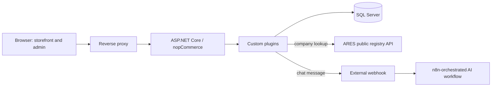

# Dobroty E-commerce & AI Automation

## Overview

This repository documents the engineering work behind **Dobroty**, a customized e-commerce platform for a food-retail business, built on the open-source **nopCommerce** framework (ASP.NET Core / .NET 9 / C#).

The platform combines a standard commerce engine with custom plugins for business automation (customer loyalty tiers, delivery eligibility, Czech invoicing, QR payments) and an externally orchestrated **AI customer-support workflow** (n8n, OpenAI, Ollama embeddings, Qdrant retrieval, PostgreSQL conversation memory) connected through a storefront chat widget.

This is a **portfolio repository**, not the production source repository. It documents architecture and decisions, includes one detailed engineering case study (security hardening of the AI chat integration), and hosts a runnable, standalone code sample (`samples/livechat/`) that does not depend on nopCommerce's own source tree.

## Business Problem

Dobroty needed to move a food-retail store from an older nopCommerce generation to a current one, add business rules that a stock e-commerce platform does not provide out of the box (Czech B2B invoicing with company lookup, postal-code delivery eligibility, automatic loyalty tiers), and give customers a fast way to ask product questions without adding a full-time support headcount.

## What I Built

- Seven custom nopCommerce plugins covering loyalty tiers, postal-code delivery eligibility, first-order discounting, Czech tax/proforma invoicing, QR payment instructions, storefront content localization, and an AI chat widget.
- Event-driven automation on top of nopCommerce's order lifecycle: proforma document generation and email queueing on order placement, gift-card activation on payment confirmation, and a scheduled task that recalculates customer loyalty tiers daily.
- Integration with the Czech ARES public registry (company lookup by IČO) to reduce manual data entry during B2B checkout.
- A storefront chat widget that forwards customer messages to an externally hosted, n8n-orchestrated AI support workflow, and renders the assistant's replies safely in the browser.
- A full security-hardening pass on that chat integration: server-side validation and error handling, safe logging, and a client-side fix for an XSS exposure in AI-generated reply rendering — covered in detail in the [case study](portfolio/CASE_STUDY.md).
- The manual, checklist-driven production deployment process used to ship the hardened chat integration, including backup verification, staged rollout and rollback readiness.

## What Is Upstream vs Custom

| Layer | Origin |
| --- | --- |
| Commerce engine (catalog, cart, checkout, admin, core services) | **Upstream nopCommerce** — not written by me |
| Base theme | **Upstream**, with targeted Razor view overrides |
| 7 custom plugins (loyalty tiers, delivery, invoicing, QR payment, discount rule, site content, AI chat widget) | **Custom**, written for this project |
| Order-event automation (document generation, gift-card activation, tier recalculation) | **Custom**, built on nopCommerce's plugin/event extension points |
| External AI support workflow (n8n, OpenAI, Ollama, Qdrant, PostgreSQL) | **Externally hosted and orchestrated**; this project integrates with it through a webhook, it is not implemented inside this codebase |
| Deployment and operations process | **Custom**, manual and checklist-driven |

nopCommerce itself is a mature open-source commerce platform; the value demonstrated here is in the extension points, the integrations, and the operational discipline around them — not in reimplementing a shopping cart.

## Architecture

Full diagram sources: [diagrams/platform-architecture.mmd](diagrams/platform-architecture.mmd), [diagrams/livechat-ai-flow.mmd](diagrams/livechat-ai-flow.mmd), [diagrams/rag-knowledge-loading.mmd](diagrams/rag-knowledge-loading.mmd), [diagrams/order-document-automation.mmd](diagrams/order-document-automation.mmd). Details: [docs/ARCHITECTURE.md](docs/ARCHITECTURE.md).

## AI Assistant Integration

The storefront chat widget forwards customer messages to an external, n8n-orchestrated workflow that uses OpenAI (`gpt-4o-mini`) to generate replies, Ollama for embeddings, Qdrant for knowledge retrieval, and PostgreSQL for conversation memory and knowledge sources. The same workflow also serves a Telegram channel and includes voice-message transcription through OpenAI.

I integrated the storefront transport layer, hardened it, and reviewed the exported workflow definitions; I did not design the retrieval architecture or train any model. See [docs/AI_ASSISTANT.md](docs/AI_ASSISTANT.md) for exactly what is verified from the workflow export versus owner-reported versus still unvalidated.

## Business Automation

- **ARES company lookup** — autofills company name, VAT number and address from the Czech business registry during checkout.
- **Customer loyalty tiers** — a scheduled task promotes/demotes customers between tiers based on lifetime order value, with wholesale customers excluded and manual admin override available.
- **Postal-code delivery eligibility** — checkout enforces a whitelist of deliverable postal codes with configurable delivery slots and a free-shipping threshold.
- **First-order discount rule** — a custom nopCommerce discount requirement rule targeting customers with no prior completed orders.
- **Order-event automation** — placing an order can trigger proforma/tax document generation and queued email delivery; marking an order paid can trigger gift-card activation.
- **QR payment instructions** — generates a scannable Czech payment QR code (SPD format) for bank-transfer orders.

Details, including which parts are still marked as partially implemented rather than fully hardened: [docs/BUSINESS_AUTOMATION.md](docs/BUSINESS_AUTOMATION.md).

## Security Hardening

The AI chat integration went through a full hardening cycle: an initial security review found an XSS exposure in how AI-generated replies were rendered and several missing server-side controls. I scoped the fix into a backend-hardening pass (input validation, timeouts, safe error handling, safe logging) and a frontend-hardening pass (Markdown sanitization with a strict allowlist, vendored dependencies, client-side robustness), verified both with targeted tests, and carried out the production deployment myself with a backup-and-rollback plan.

This is a case study in fixing **one integration**, not a claim of platform-wide security certification. Full write-up: [docs/SECURITY_HARDENING.md](docs/SECURITY_HARDENING.md) and [portfolio/CASE_STUDY.md](portfolio/CASE_STUDY.md). A standalone, runnable demonstration of both hardening passes — with its own 28 backend tests and a 56-assertion frontend/XSS test harness — is included at [samples/livechat/](samples/livechat/README.md).

## Technology Stack

| Category | Technologies |
| --- | --- |
| Backend | C#, ASP.NET Core MVC on .NET 9, nopCommerce 4.90.4, dependency injection via plugin extension points |
| Data | SQL Server, LINQ to DB, FluentMigrator |
| Frontend | Razor views, JavaScript, CSS |
| AI / automation | n8n, OpenAI, Ollama, Qdrant, PostgreSQL (for the AI workflow) |
| Frontend security dependencies | marked, DOMPurify (vendored, pinned versions) |
| Infrastructure | Linux (Ubuntu), systemd, reverse proxy, TLS certificate automation |
| Tooling | Git, manual checklist-driven deployment |

## Production and Deployment Experience

The store and AI assistant are reported operational by the business owner. The chat-hardening work described above was deployed to production by me personally, following a checklist: build a release artifact, back up and verify the existing plugin folder, stage and hash-verify the new files, swap them in, restart the service, and verify logs and functional behavior before considering the deployment complete. See [docs/DEPLOYMENT_OVERVIEW.md](docs/DEPLOYMENT_OVERVIEW.md) for the generalized process.

## Current Limitations

This portfolio is deliberately honest about what is not yet done:

- No automated regression test suite exists yet for the custom plugins.
- No CI/CD pipeline is in place; builds and deployments are manual.
- The AI workflow has not been independently re-run or evaluated for answer quality by me; it is reviewed statically from its exported configuration.
- Server-side rate limiting for the chat endpoint, and authentication between the storefront and the external AI workflow, are not yet implemented.
- Catalog-to-knowledge-base synchronization for the AI assistant is a manual process today.
- A handful of financial edge cases in the invoicing automation (covered in [docs/BUSINESS_AUTOMATION.md](docs/BUSINESS_AUTOMATION.md)) need dedicated regression tests before they should be considered fully hardened.

## Repository Scope

This is a curated, sanitized portfolio repository, not a mirror of the production codebase:

- Original nopCommerce source code is **not** included here; nopCommerce is an independently licensed open-source project.
- Original custom plugin source code is **not** copied into this repository. Where source samples are included, they are **standalone, rewritten examples** with no dependency on nopCommerce's own libraries, so they can be read and run independently — see [samples/livechat/](samples/livechat/README.md).
- No production configuration, credentials, server addresses, customer data, or business identifiers (account numbers, company registration numbers, phone numbers, emails) are included anywhere in this repository.
- AI workflow exports are included as sanitized copies for architectural review (node IDs regenerated, credentials unconfigured, personal/production identifiers removed) — see [samples/n8n/](samples/n8n/README.md). They are not runnable production configuration and are not proof of the exact JSON currently running in production.

## Documentation Map

| Document | Contents |
| --- | --- |
| [docs/ARCHITECTURE.md](docs/ARCHITECTURE.md) | System architecture, generic (no production infrastructure details) |
| [docs/AI_ASSISTANT.md](docs/AI_ASSISTANT.md) | AI/RAG workflow, with an explicit verified/reported/unvalidated/planned breakdown |
| [docs/BUSINESS_AUTOMATION.md](docs/BUSINESS_AUTOMATION.md) | Loyalty tiers, delivery, invoicing, QR payments, order-event automation |
| [docs/SECURITY_HARDENING.md](docs/SECURITY_HARDENING.md) | The LiveChat security-hardening engineering cycle |
| [docs/DEPLOYMENT_OVERVIEW.md](docs/DEPLOYMENT_OVERVIEW.md) | Generic, checklist-driven deployment process |
| [docs/PROJECT_HISTORY.md](docs/PROJECT_HISTORY.md) | Project evolution and milestones |
| [portfolio/CASE_STUDY.md](portfolio/CASE_STUDY.md) | Narrative case study: hardening the AI chat integration |
| [samples/livechat/README.md](samples/livechat/README.md) | Standalone, runnable backend + frontend sample demonstrating the hardening patterns, with its own tests |
| [samples/n8n/README.md](samples/n8n/README.md) | Sanitized, importable n8n workflow exports for the AI assistant and knowledge-loading pipelines |
| [NOTICE.md](NOTICE.md) | Third-party and upstream attribution notes |
