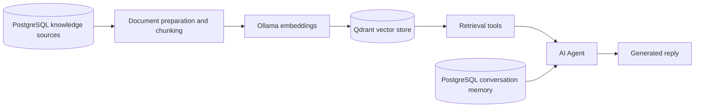

# AI Assistant Integration

Last updated: 2026-09-23

I designed and configured the n8n-orchestrated AI support workflow that the storefront chat widget connects to. This document describes the workflow's architecture and separates what is directly verified from its exported definition, what is owner-reported, and what is still open, so the AI capability described here is accurate rather than overstated.

## Architecture

(Diagram source: [diagrams/rag-knowledge-loading.mmd](../diagrams/rag-knowledge-loading.mmd); request-level flow in [diagrams/livechat-ai-flow.mmd](../diagrams/livechat-ai-flow.mmd).)

The components involved:

- **n8n** orchestrates the workflow: receiving the incoming message, invoking retrieval tools and the language model, and returning a reply.
- **OpenAI (`gpt-4o-mini`)** generates the assistant's responses.
- **Ollama** generates the embeddings used for retrieval.
- **Qdrant** is the vector store used for knowledge retrieval (a retrieval-augmented generation, RAG, pattern).
- **PostgreSQL** serves two distinct roles: it is the source of knowledge documents that get embedded into Qdrant, and it separately holds conversation memory (recent message history keyed by a conversation/session identifier).
- **Live Chat and Telegram** are the two customer-facing channels served by this workflow.
- **Voice transcription** for Telegram voice messages is performed through OpenAI's transcription API.

## Verified from exported workflow

The following is directly confirmed by inspecting the workflow's own exported definition (node types, connections and configuration) — not inferred or assumed:

- The response-generation node is configured to use OpenAI's `gpt-4o-mini` model.
- Embeddings are generated through Ollama-hosted models.
- Retrieval is backed by Qdrant, across multiple named knowledge collections plus a separate collection for conversation history.
- Conversation memory is backed by PostgreSQL, keyed by a per-conversation identifier, with a bounded context window.
- A separate workflow performs knowledge loading: it reads from PostgreSQL source tables, prepares/chunks the content, generates embeddings, and writes them into Qdrant.
- The storefront chat and a Telegram channel (including a voice-transcription path through OpenAI) are both present as trigger points into the same overall workflow.

## Sanitized workflow export

Sanitized, portfolio-safe copies of both n8n workflows described above are included in this repository at [`samples/n8n/`](../samples/n8n/README.md). Node identifiers were regenerated, credentials were removed or left unconfigured, and personal/production identifiers were replaced with placeholders before publishing. Both files were structurally validated (well-formed JSON, every connection target resolves to a real node) and were successfully imported into an isolated, disposable n8n 1.72.1 instance to confirm importability — they were not executed, and no real credentials were ever configured against them. This is not a claim that these files are byte-for-byte the exact workflow currently running in production; they are a reviewed, point-in-time snapshot. See [`samples/n8n/README.md`](../samples/n8n/README.md) for exactly what was sanitized and how the import was verified.

## Operational status

Dobroty is my own business's e-shop, so I am reporting this as both the business owner and the engineer who built the integration, not as an independent third-party verification. The assistant is actively answering real customer questions through both the storefront Live Chat and Telegram; the WhatsApp channel that appears in earlier planning material has since been removed. This status has not been independently re-verified by re-running the workflow end to end (see "Runtime reproduction" below).

## Not yet independently validated

These are real, open gaps — not implied criticisms of the workflow's design, but things that have not been checked and should not be assumed:

- **Answer quality and grounding.** No formal evaluation set or reproducible quality benchmark exists yet for the assistant's responses.
- **Conversation memory isolation.** The workflow's design keys memory by a conversation identifier; whether that isolation is enforced correctly for every retrieval path has not been independently tested.
- **Retrieval quality.** Embedding model choice, chunking strategy and retrieval relevance have not been benchmarked.
- **Runtime reproduction.** The workflow has been reviewed statically from its exported definition; it has not been independently re-run end-to-end outside of the production environment.
- **Latency and cost under load.** No measurements are available.

## Planned improvements

- A repeatable, versioned evaluation set (representative questions with expected facts) to catch regressions when the knowledge base or prompt changes.
- Automated (or at least scheduled) synchronization between the store catalog and the AI knowledge base — today, adding knowledge for new products is a manual step.
- Server-to-server authentication between the storefront and the external workflow (currently the integration relies on the webhook URL not being guessed, which is not a substitute for authentication — see [SECURITY_HARDENING.md](SECURITY_HARDENING.md)).
- Per-client rate limiting on the chat endpoint, to bound both abuse and API cost.

## Scope of the AI engineering work

I designed and configured this n8n-based AI assistant workflow myself: the agent's tool/retrieval setup, the Qdrant collections and their embeddings, the PostgreSQL-backed conversation memory, the knowledge-loading pipeline, and both the web-chat and Telegram entry points. I did not train a model or build OpenAI, Ollama or Qdrant themselves — those are third-party services I selected, configured and orchestrate. Claude, ChatGPT and Codex were used as engineering assistants during implementation, debugging and documentation; the architecture, configuration decisions, integration, validation and production deployment are mine, along with the storefront-side transport and its security hardening (see [SECURITY_HARDENING.md](SECURITY_HARDENING.md)).
