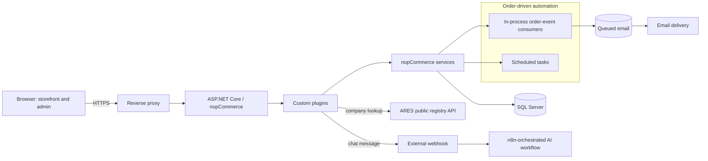

# Architecture

Last updated: 2026-09-22

This document describes the platform at architecture level. Infrastructure details are intentionally generic — no real IP addresses, hostnames, ports, VPN topology, SSH configuration or filesystem paths are included. A production deployment necessarily has these details; they are operational configuration, not architecture, and are out of scope for a public portfolio.

## System overview

(Diagram source: [diagrams/platform-architecture.mmd](../diagrams/platform-architecture.mmd).)

## Layers

The application is a **modular monolith** built on nopCommerce, not a set of independently deployed microservices.

| Layer | Responsibility | Origin |
| --- | --- | --- |
| Presentation (MVC/Razor) | Storefront and admin UI, request routing | Upstream nopCommerce, with theme overrides |
| Custom plugins | Business rules specific to this store | Custom |
| Business services | Domain logic (customers, orders, catalog, etc.) | Upstream nopCommerce, extended via plugins |
| Data access | Persistence, migrations | Upstream nopCommerce (LINQ to DB, FluentMigrator) |
| Database | Relational storage | SQL Server |

Custom plugins integrate through nopCommerce's own extension points: dependency injection registration, widget zones, scheduled tasks, and event consumers. This keeps custom logic separate from the upstream codebase rather than requiring changes to nopCommerce's own source.

## Key request flows

1. **Storefront browsing and checkout.** Browser → reverse proxy → ASP.NET Core/nopCommerce → business services → SQL Server. Standard MVC request/response; no separate API gateway or backend-for-frontend layer.
2. **Company lookup during B2B checkout.** A plugin calls the Czech ARES public registry over HTTPS to autofill company details, with a bounded timeout and no local caching of the result beyond the current request.
3. **Order-event automation.** Placing or paying for an order raises an in-process event; a plugin-registered consumer reacts synchronously within the same request lifecycle (not through a durable message broker) to generate documents or activate gift cards, then queues an email in the database for asynchronous delivery.
4. **Scheduled processing.** A background scheduled task recalculates customer loyalty tiers on a recurring basis, independent of any single request.
5. **AI chat.** The storefront widget posts a message to the backend, which validates it and forwards it to the AI webhook, hosted separately from the storefront application. The response comes back as JSON and is rendered client-side after Markdown sanitization. See [AI_ASSISTANT.md](AI_ASSISTANT.md) and [diagrams/livechat-ai-flow.mmd](../diagrams/livechat-ai-flow.mmd) for the full flow.

## What this architecture is not

- It is not a microservices architecture — everything except the external AI workflow and the ARES API runs inside a single ASP.NET Core process.
- It is not an event-streaming architecture — "events" here are in-process consumers reacting synchronously to domain events, not messages on a durable broker like Kafka or RabbitMQ. The one durable, asynchronous piece is the database-backed email queue.
- It is not a headless/API-first platform — most functionality is served through server-rendered Razor views; the handful of JSON endpoints (chat, company lookup, delivery-zone check) are small, purpose-built additions, not a general-purpose API surface.

## Infrastructure notes (deliberately generic)

Production runs on Linux under a process supervisor (systemd), behind a reverse proxy that terminates TLS and forwards traffic to the application. Certificate renewal is automated. Real hostnames, IP addresses, internal routing between proxy components, and VPN/SSH access details are operational configuration and are not published here — see [DEPLOYMENT_OVERVIEW.md](DEPLOYMENT_OVERVIEW.md) for the generalized deployment *process* rather than the specific environment.
