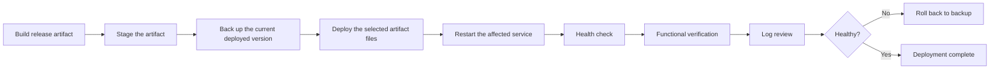

# Deployment Overview

Last updated: 2026-09-22

This document describes the **general deployment discipline** used for this project, illustrated by the LiveChat security-hardening release as an anonymized example. It intentionally excludes real server addresses, VPN or SSH configuration, and filesystem paths — those are operational details specific to one environment, not part of the engineering practice being demonstrated. The private deployment runbook this is based on is not reproduced here.

There is no CI/CD pipeline for this project today; every deployment described here was performed manually, by hand, following a fixed checklist. That is stated plainly rather than implied otherwise.

## The deployment checklist

1. **Build.** Produce a release build of the changed component from source.
2. **Stage the artifact.** Determine exactly which files the change actually touches — not by assuming, but by inspecting the currently deployed version first — and assemble only those files in a staging location outside of any live application directory.
3. **Back up the current deployed version.** Copy the entire currently deployed component (not just the file being changed) to a backup location outside the application's own directories, and verify the backup matches the live version byte-for-byte before proceeding.
4. **Deploy the selected artifact files.** Replace only the intended component, restoring correct ownership and permissions, without touching unrelated parts of the application.
5. **Restart.** Restart only after the backup and the staged replacement have both been verified.
6. **Health check.** Confirm the service came back up cleanly and has not restarted unexpectedly since.
7. **Functional verification.** Exercise the actual feature that changed, not just "the site loads" — for the LiveChat example, this meant sending real messages through the live integration and confirming a correct, context-aware reply came back.
8. **Log review.** Check for unexpected errors, and specifically check that the safe-logging controls from the hardening work (see [SECURITY_HARDENING.md](SECURITY_HARDENING.md)) are actually in effect in production, not just in the code.
9. **Rollback if necessary.** If any step surfaces a problem, restore the verified backup and restart — a full service stop is deliberately avoided unless a specific piece of the change requires it.

## Worked example: the LiveChat hardening deployment

The backend and frontend hardening changes to the chat integration were deployed in exactly this sequence. Notable details worth calling out as general lessons, independent of this specific project:

- **Don't assume the deployable file set — inspect it.** The local build output for a plugin can include shared framework build artifacts (dependency manifests, runtime configuration files) that are not actually part of the deployed component and should not be copied over. Reading the currently deployed folder first, rather than copying an entire local build output directory, avoided shipping files that did not belong.
- **Order matters when a change adds new localized text.** New translation resources were imported into the running application *before* the code that references them was deployed, so there was no window where the new code path could reference a resource that did not exist yet.
- **Verify with checksums, not by eye.** Every file in the staged artifact was hash-verified against the local build before being deployed, and the deployed files were hash-verified again after the swap — including, for this particular change, confirming that two small JavaScript libraries were served with exactly the same bytes as the sanitization work depended on.
- **A restart isn't the finish line.** After restart, the actual chat feature was exercised end-to-end through the live integration (not just a health-check endpoint), and the log output was specifically checked for the safe-logging behavior the hardening work was supposed to produce — this caught nothing in this case, but it is the step that would have caught it if the hardening had a gap.

## What this is not

This is not an automated, repeatable deployment pipeline. There is no infrastructure-as-code, no continuous integration, and no one-command rollback — every step above was a deliberate, manual, checked action. That is an honest limitation of the current project, listed as such in the top-level [README](../README.md), not something this document tries to dress up as more automated than it is.
